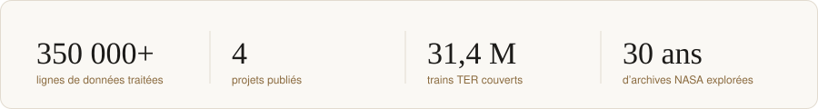
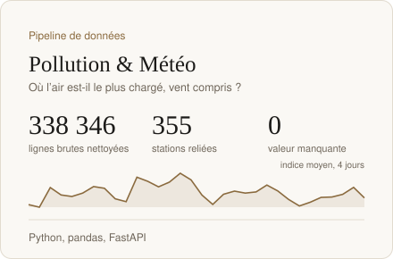
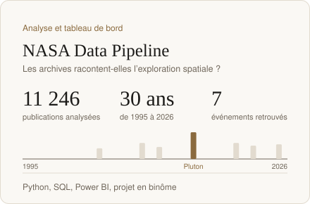
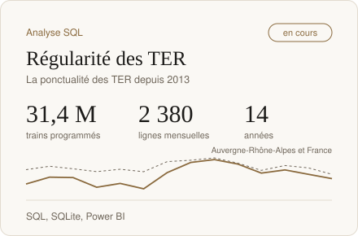
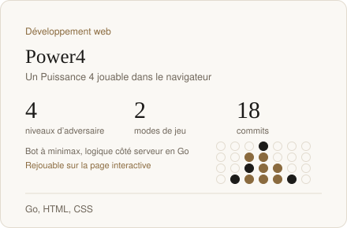
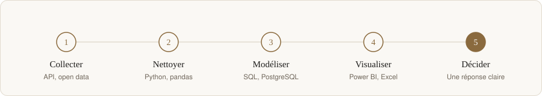
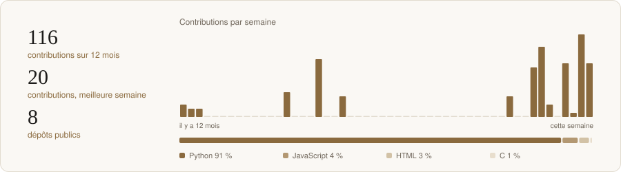

<a href="https://krm3z.github.io/krm3z/"><picture><source media="(prefers-color-scheme: dark)" srcset="visuels/banniere-sombre.svg"></picture></a>

 

**Kerem Uysal**, étudiant en Bachelor IA &amp; Data à Ynov Lyon. 
Je cherche une **alternance de data analyst** à partir de septembre 2027.

[Explorer mes projets en interactif](https://krm3z.github.io/krm3z/) &nbsp;&nbsp; [LinkedIn](https://www.linkedin.com/in/kerem-uysal-0528823a9) &nbsp;&nbsp; [E-mail](mailto:keremuysal19@icloud.com)

 

<picture><source media="(prefers-color-scheme: dark)" srcset="visuels/en-bref-sombre.svg"></picture>

 

<picture><source media="(prefers-color-scheme: dark)" srcset="visuels/titre-projets-sombre.svg"></picture>

<a href="https://github.com/krm3z/pollution-meteo-data-pipeline"><picture><source media="(prefers-color-scheme: dark)" srcset="visuels/pollution-sombre.svg"></picture></a>
<a href="https://github.com/krm3z/nasa-data-pipeline"><picture><source media="(prefers-color-scheme: dark)" srcset="visuels/nasa-sombre.svg"></picture></a>

<a href="https://github.com/krm3z/sncf-regularite-ter"><picture><source media="(prefers-color-scheme: dark)" srcset="visuels/sncf-sombre.svg"></picture></a>
<a href="https://github.com/krm3z/Power4"><picture><source media="(prefers-color-scheme: dark)" srcset="visuels/power4-sombre.svg"></picture></a>

<b>Le détail de chaque projet</b>

 

**Pollution &amp; Météo.** Question : où l’air est-il le plus chargé une fois le vent pris en compte ? J’ai relié chaque station de mesure à la station météo la plus proche (jointure géographique), aligné les données heure par heure, puis calculé un indice d’impact de 0 à 100. Les données sont exposées par une API FastAPI.

**Archives de la NASA.** Question : les publications quotidiennes de la NASA racontent-elles l’exploration spatiale ? En comptant les missions citées dans 11 246 titres, on retrouve le survol de Pluton (2015), la fin de la navette (2011) ou l’arrivée de Webb (2022). Les totaux Power BI ont été vérifiés contre les requêtes SQL. Projet en binôme, j’ai mené l’analyse.

**Régularité des TER.** Question : comment évolue la ponctualité des TER depuis 2013, région par région ? Données SNCF chargées dans SQLite. Prochaines étapes : regrouper les anciennes régions (réforme de 2016), analyse SQL, tableau de bord Power BI.

**Power4.** Un Puissance 4 jouable dans le navigateur, serveur en Go, avec un adversaire à quatre niveaux. [Faites une partie sur la page interactive](https://krm3z.github.io/krm3z/#projets).

 

<picture><source media="(prefers-color-scheme: dark)" srcset="visuels/titre-methode-titre-sombre.svg"></picture>

<picture><source media="(prefers-color-scheme: dark)" srcset="visuels/methode-sombre.svg"></picture>

 

<picture><source media="(prefers-color-scheme: dark)" srcset="visuels/titre-activite-sombre.svg"></picture>

<picture><source media="(prefers-color-scheme: dark)" srcset="visuels/activite-sombre.svg"></picture>

 

<picture><source media="(prefers-color-scheme: dark)" srcset="visuels/titre-contact-sombre.svg"></picture>

Une alternance, un projet ou une question : [keremuysal19@icloud.com](mailto:keremuysal19@icloud.com) ou [LinkedIn](https://www.linkedin.com/in/kerem-uysal-0528823a9).
