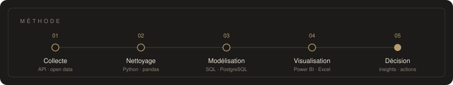

 

**Kerem Uysal** · Étudiant en IA & Data · Lyon

Je transforme des données brutes en décisions claires.

 

[LinkedIn](https://www.linkedin.com/in/kerem-uysal-0528823a9) &nbsp;·&nbsp; [E-mail](mailto:keremuysal19@icloud.com) &nbsp;·&nbsp; [lelon.fr](https://lelon.fr)

 

### Aujourd’hui

B2 IA & Data à Ynov Lyon. À la recherche d’une **alternance Data Analyst** à partir de 2027. 
Fondateur de **LELON**.

 

### Projets

| | |
|:--|:--|
| [**Pollution & Météo**](https://github.com/krm3z/pollution-meteo-data-pipeline) | Pipeline croisant qualité de l’air et données météo. Python · SQL |
| [**SNCF Régularité TER**](https://github.com/krm3z/sncf-regularite-ter) | Analyse de la ponctualité des TER à partir des données ouvertes SNCF. SQL · Power BI |
| [**NASA Data Pipeline**](https://github.com/krm3z/nasa-data-pipeline) | Extraction, structuration et analyse des données ouvertes de la NASA. Python · SQL |
| [**Power4**](https://github.com/krm3z/Power4) | Puissance 4 jouable dans le navigateur. Go |

 

### En chiffres

 

### Méthode

 

### Outils

SQL &nbsp;·&nbsp; Python &nbsp;·&nbsp; Power BI &nbsp;·&nbsp; Excel &nbsp;·&nbsp; Go &nbsp;·&nbsp; Git

 

LELON — Lyon

